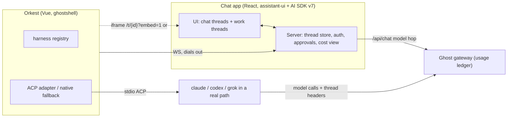

# CHAT-ORKEST — Implementation Tracker

> Living design+status doc for an owned React chat app that sits between the Ghost AI gateway and Orkest (GhostDev ghostshell). One thread store for chats and local work (Claude Code, Codex, Grok Build runs in a path).
> Companion: [HARNESS-PARITY-IMPL.md](../../../GhostDev/docs/HARNESS-PARITY-IMPL.md) (what the agent *knows*: one skill pack, many harness roots). This tracker covers how the agent is *started, watched, paused, billed and shown*.
> Research base: `D:\ware\botanic\tools\docs\research\sdk-base-alternatives.md` (assistant-ui + AI SDK v7 verdict, Codex Thread/Turn/Item lesson, ACP as permission-pause protocol).
> Home: written in the Ghost repo branch `claude/tender-maxwell-ayyek3`. Move to `D:\ware\docs\impl\CHAT-ORKEST-IMPL.md` (cross-repo trackers live in the ware repo). Fix the relative links above after the move.
> Updated: 2026-10-16
> STATUS: PLAN-ONLY

## AI Continuation Prompt

Read this tracker first, then the phase you were assigned. Four layers, each owns one question:

| Layer | Question | Repo |
|---|---|---|
| Skill pack (HARNESS-PARITY) | What does the agent know? | GhostDev |
| Harness adapter | How is the agent started, watched, paused? | Orkest (ghostshell, Vue) |
| Gateway | Who pays? | Ghost gateway |
| Thread store + UI | What happened? | Chat app (new, React) |

Botanic (LibreChat) stays the unmodified image. Do not bridge its store to the chat app. Every model call from every layer goes through Ghost (LiteLLM 1.85 + Ghost policy layer, see AI-GATEWAY-REVIEW.md) with `x-litellm-trace-id: <threadId>` and `x-litellm-spend-logs-metadata: {turn, harness, machine, source}`. Runs that cannot proxy (Claude Code on its own Max login) post usage to the ledger as `source: reported`. Orkest dials out to the chat app over WebSocket; the chat app never reaches into a machine. Approvals: Orkest pauses the harness, the chat app shows the request, the decision returns with `expectedVersion`. No model and no client may approve on its own. Wire types live in `contract/` (CO.1); `protocol.draft.ts` next to this file is the starting point. Billing default D1 (HANDOFF.md): Claude Code work threads run on an API-key lane through Ghost; never through `ghost-claude-broker`. Only tick checklist items of your own phase. Report deviations in LOGBOOK, never silently.

## Architecture



**Thread kinds.** `chat`: the chat server runs the turn against Ghost. `work`: Orkest runs the turn in a path through a harness. Same store, same renderers, different executor.

**Data model (Codex shape).**

- Thread: `id`, `kind`, `account`, `title`, `status` (`idle | running | waiting_approval | done | failed | interrupted`), `version`. For `work`: `machine`, `cwd`, `harness`, `harnessVersion`, `packHash`, `level`.
- Turn: `id`, `threadId`, `input`, `status`, `usage` (from Ghost, summed by the `turn` field in `x-litellm-spend-logs-metadata`), `startedAt`, `endedAt`.
- Item: `message | reasoning | tool_call | command | file_change | approval_request | artifact | error`. `command` has cmd, cwd, output, exit code. `file_change` has path and unified diff. `approval_request` has id, summary, options, `expectedVersion`, resolution.

**Wire: Orkest ↔ chat app** (JSON over WebSocket, Orkest dials out, auth by machine token):

| Direction | Messages |
|---|---|
| Orkest → chat | `hello {machine, roots[], harnesses[]}` · `item/started` · `item/delta` · `item/completed` · `approval/request` · `turn/completed` · `thread/status` |
| chat → Orkest | `thread/start {threadId, cwd, harness, level, prompt?, toolPolicy}` · `turn/start` · `turn/steer` · `turn/interrupt` · `approval/resolve {id, decision, expectedVersion}` |

**Harness registry (Orkest).** One row per harness, same `name` keys as GhostDev `template/harness-registry.json`:

```json
{ "name": "claude-code", "launch": ["claude-code-acp"], "protocol": "acp",
  "fallback": { "launch": ["claude", "-p", "--output-format", "stream-json"], "protocol": "claude-stream-json" },
  "gatewayEnv": { "ANTHROPIC_BASE_URL": "{ghost}/anthropic", "ANTHROPIC_CUSTOM_HEADERS": "x-litellm-trace-id: {thread}\nx-litellm-spend-logs-metadata: {meta}" },
  "skillRoots": [".claude/skills"], "approvals": true }
```

**Embedding into Orkest (Vue).** No vuera. (A) Full view: iframe or tab at `/t/{id}?embed=1` with a small `postMessage` contract (`open-thread`, `thread-status`, `approval-needed`). (B) Inline: the chat app ships a `<ware-thread thread-id compact>` custom element (React inside a shadow root). Vue uses it via `compilerOptions.isCustomElement`.

**Ghost must speak:** Anthropic `/v1/messages` (Claude Code), OpenAI `/v1/responses` (Codex), OpenAI-compatible chat completions (chat app via `@ai-sdk/openai-compatible`, and Grok Build if it uses xAI's API), all with streaming usage and thread header passthrough. LiteLLM covers `/v1/messages` (documented Claude Code setup); Responses for Codex and xAI for Grok are to verify. The Max broker is never a work-thread upstream (no tools, no streaming).

## Open Questions

> ≤3 items. Defaults accepted with rationale; override before the phase starts.

1. **Q:** Where does the chat app live?
   **Resolution:** New repo `D:\ware\chat` with `app/` (Next.js, React 19), `contract/` (wire types, Zod schemas), `embed/` (custom element build).
   > Rationale: Orkest is Vue and Botanic is the unmodified LibreChat image; neither should host a React app. `contract/` must be importable by Orkest without React.
   > Override: put it under `D:\ware\botanic\` only if Botanic's tooling repo becomes the home of all owned chat code.

2. **Q:** Thread store database?
   **Resolution:** PostgreSQL with Drizzle. Tables `threads`, `turns`, `items`, `approvals`. `items.payload` is JSONB keyed by `type`.
   > Rationale: relational turns and approvals with `version` columns make `expectedVersion` a single conditional update. Postgres is already in the stack.
   > Override: SQLite for a single-user local first cut if Postgres slows CO.2.

3. **Q:** ACP or native protocol per harness?
   **Resolution:** ACP first for every harness. Native fallback only where the CO.0b spike shows ACP missing headless mode, usage, or permission round trip.
   > Rationale: one Orkest adapter instead of N; ACP's `session/request_permission` maps onto `approval_request`. Its unfinished remote transport does not matter because Orkest uses stdio locally.
   > Override: if two of three harnesses need the fallback, make native the default and drop ACP.

## Implementation Status

| Phase | State | Repo | Model | Effort | Description |
|---|---|---|---|---|---|
| CO.0a | [ ] not started | Ghost gateway | Sonnet | high | Spike: three protocol shapes, streaming usage, thread headers. |
| CO.0b | [ ] not started | Orkest | Sonnet | high | Spike: ACP drives Claude Code, Codex, Grok headless with a permission round trip. |
| CO.1 | [ ] not started | chat | Opus | high | Contract package: thread model, wire messages, harness registry schema. |
| CO.2 | [ ] not started | chat | Sonnet | high | Chat app MVP: store, `/api/chat` → Ghost, thread list, `/t/{id}?embed=1`. |
| CO.3 | [ ] not started | Orkest | Sonnet | high | WS link, harness registry, ACP adapter (Claude Code first), thread stamping. |
| CO.4 | [ ] not started | Orkest + chat | Sonnet | med | Methodology check becomes a work thread shown via iframe. |
| CO.5 | [ ] not started | chat + Orkest | Sonnet | high | Local-work UX: command, diff, approval renderers; interrupt, steer. |
| CO.6 | [ ] not started | chat + Orkest | Sonnet | med | `<ware-thread>` custom element and Orkest inline panel. |
| CO.7 | [ ] not started | Orkest + chat | Sonnet | med | Codex + Grok adapters, chat→work handoff. |

Dependencies: CO.0a, CO.0b, CO.1 and HARNESS-PARITY run in parallel. CO.2 needs CO.1 + CO.0a. CO.3 needs CO.1 + CO.0b (+ HARNESS-PARITY.2 for `packHash`). CO.4 needs CO.2 + CO.3. CO.5 → CO.6 → CO.7.

## Checklist

### Phase 0a — Gateway spike (Ghost gateway)

- [ ] CO.0a.1 Streaming call through Ghost on `/v1/messages`, `/v1/responses`, chat completions with an Orkest test key. Record which work and which need config.
- [ ] CO.0a.2 `x-litellm-trace-id` lands in `LiteLLM_SpendLogs.session_id`; `x-litellm-spend-logs-metadata` lands in the row metadata, on all three shapes. Add the check to `smoke.sh`.
- [ ] CO.0a.3 Streaming usage is captured for each shape (cost on the spend row).
- [ ] CO.0a.4 One tool round trip per shape survives the hop.
- [ ] CO.0a.5 One real `claude -p` with `ANTHROPIC_BASE_URL` + `ANTHROPIC_AUTH_TOKEN` (virtual key) → Ghost, on a tool-capable API lane. Record the cost of the run vs the harness's own reported cost.
- [ ] CO.0a.6 Add consumer `orkest-<machine>` in `consumers.json`: tool-capable lanes only, no `claude-max*`. Smoke asserts the broker refuses it.
- [ ] CO.0a.7 Write `docs/research/gateway-shapes-spike.md` in the gateway repo. Ledger API and reported usage (AI-GATEWAY-REVIEW items 2-3) are designed there, built in CO.2.

### Phase 0b — ACP spike (Orkest)

- [ ] CO.0b.1 Drive Claude Code through its ACP adapter from a 50-line Node script: `initialize`, `session/new {cwd}`, `session/prompt`, stream updates.
- [ ] CO.0b.2 Same for Codex (ACP adapter). Same for Grok Build: confirm whether it speaks ACP at all.
- [ ] CO.0b.3 Trigger a write tool and answer `session/request_permission` from the script, allow and deny.
- [ ] CO.0b.4 Per harness: does the gateway base URL env reach the harness through the adapter? Does any event carry token usage?
- [ ] CO.0b.5 Decision table (ACP ok / native fallback) in `docs/research/acp-harness-spike.md`. Feeds Open Question 3.

### Phase 1 — Contract (chat repo `contract/`)

- [ ] CO.1.1 Create repo `D:\ware\chat` with `contract/` package, no React dependency.
- [ ] CO.1.2 Port `protocol.draft.ts` to Zod schemas + inferred types: Thread, Turn, Item union, wire messages both directions.
- [ ] CO.1.3 Harness registry schema; harness `name` values match GhostDev `template/harness-registry.json`.
- [ ] CO.1.4 Fold in CO.0a/CO.0b results (usage fields, fallback protocols).
- [ ] CO.1.5 Round-trip tests: every message parses its own sample fixture.

### Phase 2 — Chat app MVP (chat repo `app/`)

- [ ] CO.2.1 Next.js + assistant-ui + AI SDK v7. `/api/chat` → `createOpenAICompatible` → Ghost, with thread/turn headers.
- [ ] CO.2.2 Postgres + Drizzle store (`threads`, `turns`, `items`, `approvals`); `ThreadHistoryAdapter` round-trips `UIMessage`.
- [ ] CO.2.3 Thread list with kind filter; turn cost and served model from the Ghost ledger API (`GET /ledger/threads/{id}`, built in the gateway repo alongside this phase, plus `POST /ledger/usage` for reported runs).
- [ ] CO.2.4 `/t/{id}` and `/t/{id}?embed=1` (no chrome) + `postMessage` contract.
- [ ] CO.2.5 Auth: single-user token is fine for MVP; account id is on every thread.

### Phase 3 — Orkest link (Orkest)

- [ ] CO.3.1 Outbound WS client with machine token, reconnect, `hello` with roots and harnesses.
- [ ] CO.3.2 Harness registry file + loader using `contract/` schema.
- [ ] CO.3.3 ACP adapter: wire messages ↔ ACP; Claude Code only in this phase.
- [ ] CO.3.4 Gateway env injection per registry row; thread/turn ids in headers.
- [ ] CO.3.5 Stamp `harness`, `harnessVersion`, `packHash` (from GhostDev mark) on `thread/start`.
- [ ] CO.3.6 `cwd` must be inside a registered root; anything else is rejected.

### Phase 4 — Methodology check as a work thread

- [ ] CO.4.1 The Methodology check button sends `thread/start` with canned prompt, `level` → model + budget, read-only `toolPolicy`.
- [ ] CO.4.2 Orkest shows the thread in an iframe (`/t/{id}?embed=1`); status via `postMessage`.
- [ ] CO.4.3 Cost shown on the button's run row equals Ghost's usage for that thread.

### Phase 5 — Local-work UX

- [ ] CO.5.1 Renderers: `command` (collapsible terminal), `file_change` (diff), `approval_request` (approve/deny).
- [ ] CO.5.2 Approval round trip with `expectedVersion`; a stale decision is rejected and the UI refreshes.
- [ ] CO.5.3 `turn/interrupt` and `turn/steer` from the UI.

### Phase 6 — Inline embed

- [ ] CO.6.1 `embed/` builds `<ware-thread>` (React in shadow root), emits `CustomEvent`s (`approval-resolved`, `run-finished`).
- [ ] CO.6.2 Orkest uses it inline under the Methodology check; Vue `isCustomElement` configured.

### Phase 7 — More harnesses and handoff

- [ ] CO.7.1 Codex row (ACP or `codex app-server` fallback per CO.0b).
- [ ] CO.7.2 Grok Build row (per CO.0b).
- [ ] CO.7.3 "Run this in project X" from a chat thread creates a linked work thread.

## Current State (2026-10-16)

Plan-only. No code. Botanic runs unmodified. HARNESS-PARITY is plan-only in GhostDev (commit `3d7580a`).

## Known Bugs

_(none yet)_

## What Needs Testing

- CO.0a — usage rows in Ghost carry the thread id for all three shapes.
- CO.0b — allow and deny both reach the harness; harness respects deny.
- CO.1 — fixtures round-trip.
- CO.3 — a `cwd` outside registered roots is refused; reconnect resumes streaming.
- CO.4 — Methodology check cost in Orkest equals Ghost's total for the thread.
- CO.5 — stale `expectedVersion` is refused.

## Key Files Reference

| File | Purpose |
|---|---|
| `docs/chat-orkest/HANDOFF.md` | Decisions, defaults, repos, traps. Read first. |
| `docs/chat-orkest/GROK-RUN.md` | Orchestrator prompt for the big run. |
| `docs/chat-orkest/AI-GATEWAY-REVIEW.md` | What the gateway is, verdict, alternatives, improvement list. |
| `docs/chat-orkest/protocol.draft.ts` | Starting point for CO.1 types. |
| `docs/chat-orkest/ORCHESTRATION.md` | How to run this with an orchestrator session and worker sessions; prompts. |
| `D:\ware\chat\contract\` | Planned. Wire contract. |
| `D:\ware\chat\app\` | Planned. React chat app. |
| `D:\ware\chat\embed\` | Planned. `<ware-thread>`. |
| GhostDev `template/harness-registry.json` | Harness names shared with Orkest's registry. |
| `D:\ware\botanic\tools\docs\research\sdk-base-alternatives.md` | Research base. |
